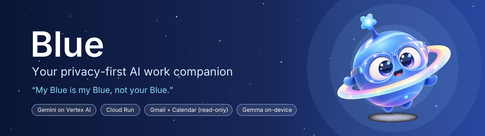
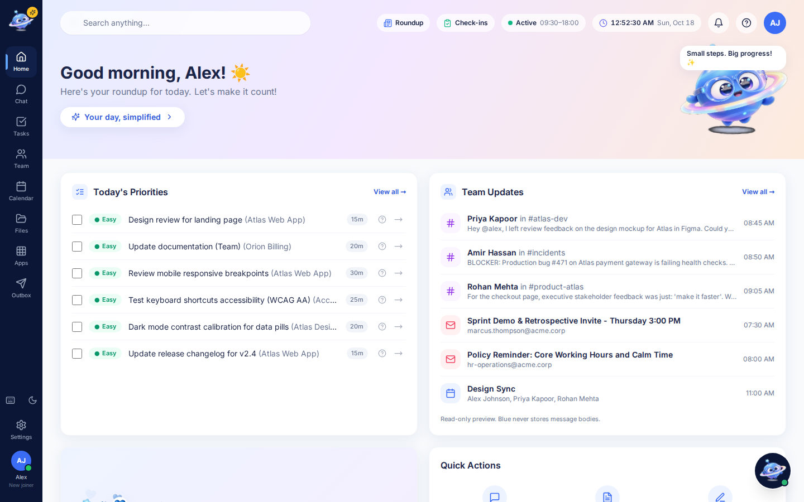
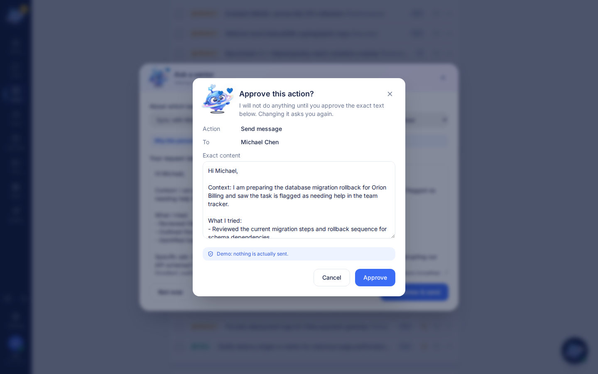
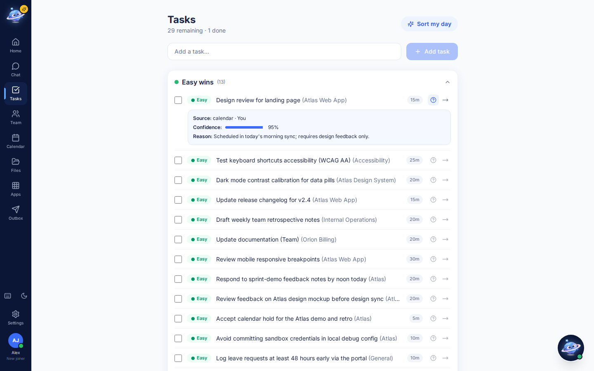
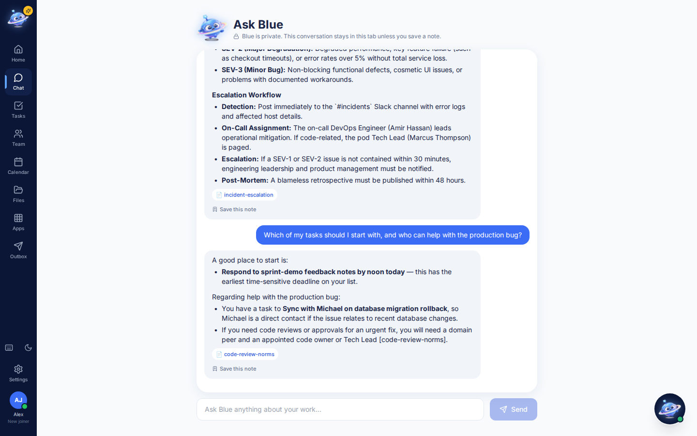
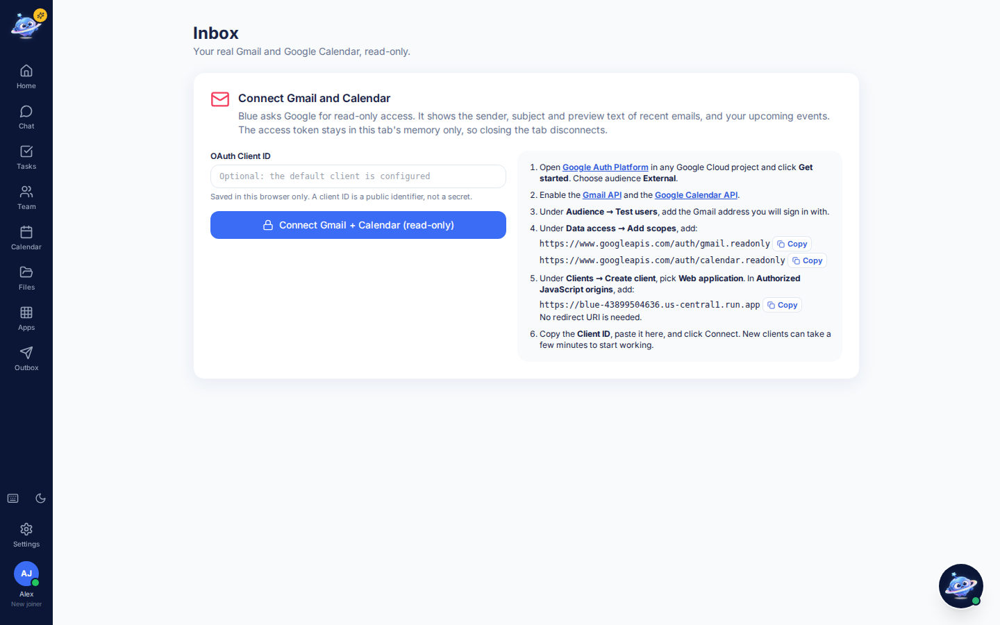
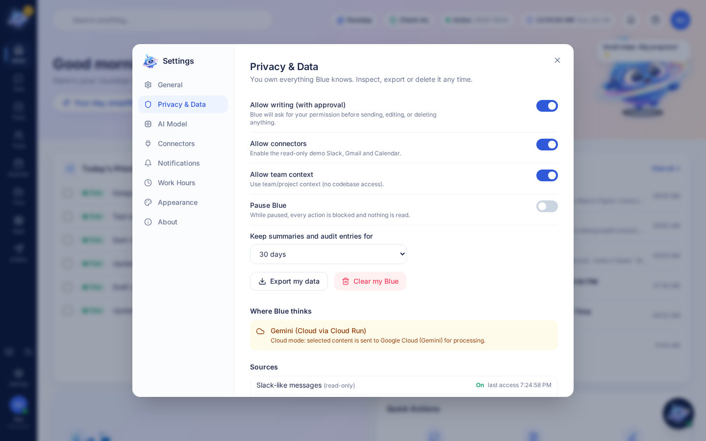

<p align="center">
  
</p>

<p align="center">
  <a href="https://blue-43899504636.us-central1.run.app"><b>Live demo</b></a> ·
  <a href="#features">Features</a> ·
  <a href="#architecture">Architecture</a> ·
  <a href="#run-locally">Run locally</a> ·
  <a href="FutureWork.md">Roadmap</a>
</p>

<p align="center">
  
  
  
  
  
</p>

# Blue: Work & Productivity Companion

> **"My Blue is my Blue, not your Blue."**

Blue is a privacy-first AI work companion that belongs to the employee, not the company. It reads only the sources you approve, turns them into a calm morning roundup, and sorts your work into **Easy wins / Next up / Needs senior help**. It also helps you ask the right person early. Blue drafts messages, but nothing is sent, scheduled or changed until you approve the exact content. Managers get no dashboard, no scores and no access to your memory.

Built for the **Google Cloud AI Builder Cup 2026**, theme *Future of Work & Enterprise Productivity*.

<p align="center">
  
  
</p>

## Features

| | |
|---|---|
| **Morning roundup** | Gemini turns messages, mail and events into a short plan. Every line shows its source. |
| **Task triage** | Easy wins, Next up and Needs senior help, each with effort, estimate, confidence and a **Why?** explanation. |
| **Ask a senior** | Suggests the best colleague from team skills, drafts the request, proposes a meeting and walks through accept and schedule. |
| **Approval gate** | Every write shows a preview and needs a click bound to a SHA-256 hash of the exact recipient and text. Sending is simulated into a demo outbox. |
| **Ask Blue chat** | Answers from your open tasks, policy documents (with citations), uploaded text files and connected mail and calendar. |
| **Real Gmail + Google Calendar** | Read-only Google sign-in. Shows the last 48 hours of mail, searches your whole mailbox, lists upcoming events and shows live progress while connecting. One-time codes are masked before display or any AI call. |
| **Bring your own OAuth client** | Testers can paste their own OAuth Client ID in the app, with step-by-step setup instructions next to the field. |
| **Persistent uploads** | Uploaded files are saved in encrypted local memory. Blue searches the text of `.txt`, `.md` and `.csv` files when answering. |
| **Privacy & Data panel** | Per-source switches, audit log, retention, export, pause and **Clear my Blue**. |
| **Encrypted local memory** | IndexedDB encrypted with a non-extractable AES-GCM 256 key from WebCrypto. |
| **Work-hours presence** | Wakes 30 minutes before your workday and rests after hours. |
| **Wellbeing tools** | Private check-ins, a focus timer, "make it smaller" step plans and specific, restrained praise. |
| **Model choice** | Gemini in the cloud after one-time consent, or Gemma on-device in the browser (experimental). A clearly labelled offline demo mode keeps the app usable. |

<p align="center">
  
  
  
</p>

## How Google services are used

- **Gemini 3.8 Flash on Vertex AI** (via `@google/genai`) does the roundup, triage, drafting and chat, using JSON response schemas. It's only called after a one-time consent prompt, and content is filtered first.
- **Cloud Run** hosts one container that serves the UI and `/api`. It runs as a least-privilege service account (`roles/aiplatform.user` only) and uses no API keys in production.
- **Gmail API and Google Calendar API** (`gmail.readonly`, `calendar.readonly`) are reached through **Google Identity Services**. The browser calls Google directly, and the token stays in the tab's memory only.
- **Gemma** (E2B / E4B) can run on-device through LiteRT-LM and WebGPU, so no data leaves the device (experimental).
- **Cloud Build, Artifact Registry and budget alerts** handle deployment and cost control.

**Why no Firebase or Firestore?** This is deliberate. Each user's memory stays encrypted in their own browser, so there is no central database of employee data to secure, breach or repurpose for monitoring.

## Privacy by design

- **Read-only by default.** Every source is off until you enable it. A deterministic policy gate outside the model decides every action.
- **Never reads your code.** Repositories, diffs, secrets and one-time codes are filtered out in the client and again on the server.
- **Always blocked:** codebase reads, Blue-to-Blue and screen capture are denied even when every setting is on.
- **Body-free logs:** the server logs only method, path, status and duration, and the audit log stores short descriptors, never message bodies.
- **You're in control:** pause, export or wipe your data at any time.

<p align="center"></p>

## Architecture

```
┌──────────────── Browser (React app) ────────────────┐      ┌──────── Google Cloud ────────┐
│ UI · Policy gate · Privacy filters                  │      │ Cloud Run "blue"             │
│ Encrypted memory (IndexedDB + AES-GCM) · Audit log  │─────▶│ Express: UI + /api/ai        │
│ Gemma (LiteRT-LM, WebGPU, optional)                 │ HTTPS│ rate limit · privacy check   │
│ Google sign-in token (memory only)                  │      │        │                     │
└───────────────┬─────────────────────────────────────┘      │        ▼                     │
                │ direct, read-only                          │ Vertex AI · Gemini 3.8 Flash │
                ▼                                            └──────────────────────────────┘
      Gmail API · Google Calendar API
```

## Measured performance (live Cloud Run, 18 Oct 2026)

| Measurement | Result |
|---|---|
| Gemini structured triage call | median 3.6 s (range 3.1 to 17.2 s) |
| Ask Blue answer, end to end | 4.1 to 4.9 s |
| Code diff sent to the AI endpoint | rejected (HTTP 422) in 0.39 s, never reaches Gemini |
| Full morning roundup (20+ items, 49 tasks) | about 110 s (next optimisation target) |
| Lighthouse accessibility | 96 / 100 |
| Unit tests | 39 / 39 passing |

## Project layout

```
client/     React 18 + TypeScript + Vite + Tailwind
  src/core/   policy gate, encrypted memory, AI providers, Google connector, features
  src/pages/  Home, Tasks, Chat, Inbox, Calendar, Files, Team, Apps, Outbox
server/     Node 20 + Express + @google/genai (Gemini proxy, rate limits, privacy filter)
e2e/        Playwright smoke test
docs/       Banner and screenshots
Dockerfile  Multi-stage build for Cloud Run
FutureWork.md  Limitations and roadmap
```

## Run locally

```bash
cp .env.example .env    # USE_VERTEX=true, GOOGLE_CLOUD_PROJECT, GOOGLE_CLOUD_LOCATION=global, GEMINI_MODEL=gemini-3.8-flash
gcloud auth application-default login

cd server && npm install && npm run dev   # http://localhost:8080 (loads ../.env)
cd client && npm install && npm run dev   # http://localhost:5173, proxies /api to :8080
cd client && npx vitest run               # unit tests
```

If no model is reachable, Blue switches to a clearly labelled offline demo mode.

## Deploy (Cloud Run)

```bash
gcloud run deploy blue --source . --region us-central1 \
  --service-account blue-run@<PROJECT_ID>.iam.gserviceaccount.com \
  --allow-unauthenticated --max-instances 2 --memory 512Mi \
  --set-env-vars USE_VERTEX=true,GOOGLE_CLOUD_PROJECT=<PROJECT_ID>,GOOGLE_CLOUD_LOCATION=global,GEMINI_MODEL=gemini-3.8-flash
```

The runtime service account needs only `roles/aiplatform.user`. Later deploys only need `gcloud run deploy blue --source . --region us-central1`, because settings carry over.

## Gmail + Google Calendar setup

1. Enable the APIs: `gcloud services enable gmail.googleapis.com calendar-json.googleapis.com`
2. In **Google Auth Platform**, set the audience to *External* and add sign-in accounts under **Test users**. Under **Data access**, add the `gmail.readonly` and `calendar.readonly` scopes.
3. Go to **Clients**, then *Create client*, then *Web application*. Under **Authorized JavaScript origins**, add `http://localhost:5173` and your Cloud Run URL.
4. Choose one way to provide the Client ID:
   - Set it for everyone: add `GOOGLE_OAUTH_CLIENT_ID` to `.env`, and for Cloud Run run `gcloud run services update blue --region us-central1 --update-env-vars GOOGLE_OAUTH_CLIENT_ID=<id>`.
   - Paste it in the app under **Apps** or **Inbox**. It is stored in that browser only.

## Roadmap

A faster roundup, Slack and Teams connectors, Google app verification, verified on-device Gemma, a desktop sidebar app, Blue-to-Blue with consent from both people, encrypted sync, multilingual support and voice. See [FutureWork.md](FutureWork.md).

---

<sub>All sample workspace data is fictional. Sending is simulated: approved messages land in a demo outbox.</sub>
